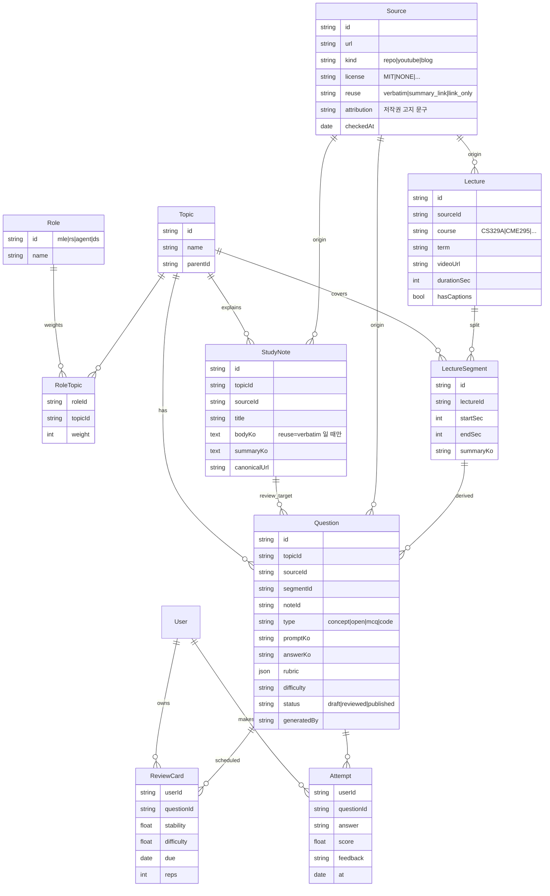
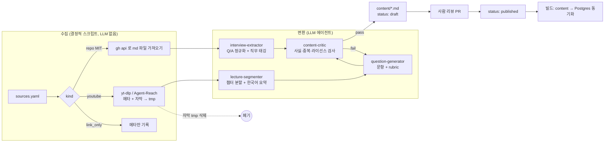

# ARCHITECTURE

## 추천 스택 (1안)

| 층 | 선택 | 이유 |
|---|---|---|
| 앱 | **Next.js App Router on Vercel** (Node.js 런타임) | 참고 사이트와 같은 계열이라 UX 패턴을 그대로 옮기기 쉽다. 콘텐츠 페이지를 SSG/ISR 로 만들어 SEO 유입을 받는다 (참고 사이트의 핵심 성장 경로) |
| 콘텐츠 원본 | **Git 저장소 `content/` (Markdown + frontmatter)** | 라이선스·출처를 파일 단위로 추적하고 PR 로 검수한다. LLM 생성물도 사람 리뷰를 거쳐야 하므로 DB 직접 쓰기보다 안전하다 |
| DB | **Postgres (Vercel Marketplace, 예: Neon)** + Drizzle | 사용자 상태(복습 스케줄, 답안, 진도) 전용이다. 콘텐츠는 빌드 시 동기화한다 |
| 검색 | Postgres FTS → 필요 시 pgvector | Algolia 비용 없이 시작한다. 문항 수천 개 규모에는 충분하다 |
| 복습 | **FSRS** (`ts-fsrs`) | 참고 사이트에 없는 진짜 SRS다. 차별화 1순위 |
| 인증 | Clerk (Marketplace) | 참고 사이트와 동일하고 설정 비용이 가장 낮다 |
| LLM (런타임) | AI SDK 7 + Vercel AI Gateway (`"provider/model"` 문자열) | 서술형 답안 채점·힌트에 쓴다. 공급자를 바꿔도 코드는 그대로 둔다 |
| 수집 스크립트 | **Python 3.12 + uv** (`pipeline/`) | Agent-Reach·yt-dlp 가 Python 생태계다. 앱(TS)과 분리하고, 둘은 `content/` 파일 계약으로만 연결한다. 특정 에이전트 SDK 에 묶지 않는다 |

기각한 대안: 콘텐츠를 CMS 로 운영하는 안은 출처·라이선스 메타를 PR 리뷰로 강제할 수 없어 기각했다. Algolia 는 MVP 규모 대비 과잉이다.

## 데이터 모델



불변식:
- `Source.reuse = link_only` 인 소스에서 `Question.answerKo` 원문을 가져오지 않는다. 빌드 스크립트가 검사한다.
- `Question.status = published` 는 사람 리뷰를 거친 것만 허용한다. `generatedBy` 에 모델 ID 를 기록한다.
- `LectureSegment` 에는 요약과 타임스탬프만 저장한다. 자막 전문은 저장하지 않는다.
- `StudyNote.bodyKo` 는 `reuse = verbatim` 일 때만 채운다. 그 외에는 `summaryKo` + `canonicalUrl` 만 둔다.
- 오답 문항의 "개념 복습"은 `Question.noteId` 또는 `segmentId` 로 이동한다. 강의는 `?t=<startSec>s` 딥링크로 연다.

### `Question.rubric` 구조

```json
{
  "mustHave": ["ReAct", "tool call 결과를 다음 추론에 주입"],
  "criteria": [
    { "id": "c1", "desc": "Reason/Act 교대 루프를 설명", "points": 4 },
    { "id": "c2", "desc": "CoT 대비 장점(외부 정보 접지)", "points": 3 },
    { "id": "c3", "desc": "실패 모드(루프·환각된 도구 인자) 1개 이상", "points": 3 }
  ],
  "deductions": [{ "desc": "도구 호출을 학습 시점 지식과 혼동", "points": -2 }],
  "modelAnswerKo": "…",
  "reviewTarget": { "noteId": null, "segmentId": "cs329z-l06-s03" }
}
```

`grader` 는 criterion 별 점수와 근거 문장을 반환한다. 총점은 criterion 합에서 감점을 뺀 값이다. 이렇게 하면 채점이 설명 가능해지고, M4 평가셋으로 항목 단위 회귀 검사를 할 수 있다.

## 수집 파이프라인 (오프라인, 앱 런타임과 분리)



- 수집은 결정적 스크립트로 한다. LLM 이 도구를 직접 고르게 하지 않는다. 재현성이 생기고 토큰도 아낀다.
- 변환 단계는 evaluator-optimizer 패턴이다: generator 가 만들고 critic 이 판정한다. critic 은 generator 와 **다른 모델 계열**을 쓴다 (`docs/AGENTS.md`).
- 런타임 LLM 은 채점·힌트에만 쓴다. 콘텐츠 생성은 런타임에 하지 않는다.
